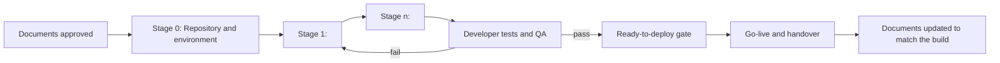

# Rule 65 — Project Documentation and Implementation Plan

> **Scope: shared by Modes A, B, and C.** This rule is not preloaded; `/doc-suite`,
> `/new-suite`, and `/mod-suite` read it in the step that writes the document. One
> template serves all three modes: `templates/documentation-and-implementation-plan.md`.

## 1. What it is
The Project Documentation and Implementation Plan is the developer's map of the suite
and the route from the documents to a working system. It answers, in one place: which
documents exist and what each decides, in what order to read them, how the build runs in
stages, what "done" means at each level, and which document to update when the code
changes. It is written **last**, after the suite's consistency review, because it
summarizes the finished documents.

- **Audience:** the development team and the technical lead first; the project manager
  uses sections 5, 8, and 11 to follow the build.
- **It summarizes; it never decides.** Every stage, criterion, date, risk, and role comes
  from a document already in the suite, cited by section. A fact that no document holds is
  a gap in that document: add it there first (Rule 00, item 4), then cite it. The one
  exception is the working agreement in section 4, which may add **Proposed** practices.
- **Tone:** the Developer Manual's tone (Rule 10): precise, explanatory, plain. The Read
  This First page follows Rule 12.

## 2. File name and place

| Mode | File | Written by | After |
|------|------|------------|-------|
| A | `output/mode-a/<slug>/06-documentation-and-implementation-plan.md` | `/doc-suite` Step 3b | The Step 3 review |
| B | `output/mode-b/<slug>/10-documentation-and-implementation-plan.md` | `/new-suite` Step 3b | The Step 3 review |
| C | `output/mode-c/<slug>/08-documentation-and-implementation-plan.md` | `/mod-suite` Step 3b | The Step 3 review |

`--only implementation` writes it alone, provided the suite it summarizes exists. The
INDEX lists it, the Word export includes it, and the build repository starter kit copies
it with the rest of the suite into `docs/design/` and names it as the first file to read
in the kit's `CLAUDE.md` and `README.md`.

## 3. Where each section gets its facts

| Section | Mode A (existing project) | Mode B (new project) | Mode C (modernization) |
|---------|---------------------------|----------------------|------------------------|
| 2 The Project in One Page | Profile sections 1–3; Plan section 3 (current state) | Brief sections 1–3; Design section 3 (stack) | Brief: current system, decisions, Target Tech Stack |
| 3 Documentation Set | The Mode A Rule 40 table; each document's Document Control block | The Mode B Rule 40 table; Document Control blocks | The Mode C Rule 40 table; Document Control blocks |
| 4 Implementation Approach | Plan sections 5–6 (finish order) | Plan section 6 (phases); Design section 15 (ADRs) | Brief (strategy); Migration Plan (increments, parallel run, cutover) |
| 5 Implementation Stages | Plan WBS and milestones; Plan Quality section | Plan WBS and phases; Test Plan test cases | Migration Plan increments and phases; Migration Test Plan |
| 6 Traceability | Plan feature IDs (F-xx); Developer Manual git workflow | Requirements Traceability Matrix; starter kit git rule | Requirements Traceability Matrix; Feature Disposition; starter kit git rule |
| 7 Development Workflow and Tooling | Developer Manual (setup, standards, CI/CD, git); repo docs | Design section 14; starter kit (Mode B Rule 40 section 11) | Target Design repository section; starter kit (Mode C Rule 40 section 10) |
| 8 Quality Gates and Definition of Done | Plan Definition of Done and gate (Rule 45 section 5) | Plan section 13; Test Plan exit criteria; gate | Migration Plan gate; Migration Test Plan parity and cutover criteria |
| 9 Keeping the Documents True | Rule 55 (Mode A order); `/doc-suite <slug> <change>` | Rule 55 (Mode B order); `/new-suite <slug> <change>`; `/new-gap-check` once code exists | Mode C Rule 50 section 5; `/mod-suite <slug> <change>`; `/new-gap-check`, then `/doc-suite` on the new code |
| 10 Roles and Responsibilities | Profile section 2 (roles); Plan RACI | Brief section 3; Plan section 7 | Brief (approvers, testers); Migration Plan RACI |
| 11 Timeline Summary | Plan milestones | Plan section 6 | Migration Plan phases and cutover date |
| 12 Risks to the Implementation | Plan Risks | Plan section 9 | Migration Plan risk register |

Use the mode's evidence rule for every citation (Rule 30 of the active mode). Mode A
statements about the code keep their `path:line` citations when they are copied; a
statement about a document cites the document and section instead.

## 4. Section rules
1. **Read This First (Rule 35).** The questions table answers at least: What am I
   building? Where do I start on day one? Which document decides what? What does "done"
   mean? When is it ready? Who approves? What do I update when I change something? Its
   picture is the **implementation route** flow below. Because the document has more than
   8 numbered sections, add the Where to Find What table.
2. **Document Inventory (3.1).** One row per file in the output folder, plus the repo docs
   (Mode A) or starter kit (Modes B and C) as a final row. Version and status are copied
   from each Document Control block on the day of writing; a document that is not yet
   written is listed with status "Planned".
3. **Where Each Fact Lives (3.3).** Exactly one document per kind of fact. If two documents
   both hold a fact today, pick the one the mode's Rule 40 names as the source and note the
   other as a copy.
4. **Stages (5).** Stage 0 is always "Repository and environment" (clone or create the
   repository, apply the starter kit, run the planned setup commands). The other stages are
   the plan's phases or increments, with the same names and order. Every Must work item
   appears in exactly one stage. Exit criteria are the plan's; tests are the test plan's
   IDs. In Mode C, the parity stage and the cutover rehearsal are separate rows.
5. **Definition of Done (8).** Copy the ready-to-deploy gate word for word from the plan
   (Rule 45 section 5). Never loosen or tighten it here.
6. **Keeping the Documents True (9).** Every trigger names the factory command that applies
   the change (Rule 55 or Mode C Rule 50 section 5) and the order of documents it touches.
   Include the hand-over to Mode A once the code exists (Modes B and C).
7. **Roles (10).** Roles only (Rule 10). Reuse the plan's RACI roles and the evidence base's
   approver and tester groups.
8. **Markers.** Dates, costs, and stack layers keep the markers they carry in the source
   documents (`[TBD]`, `[ASSUMPTION]`, `[DECISION]`, `[VERIFY]`). Collect them in Open
   Items like any other document; the INDEX counts them.

### Implementation route flow
Use this Mermaid source as the Read This First picture, with the stage names of the plan:

## 5. Checks before reporting it done
- [ ] Every stage, criterion, date, risk, and role cites a suite document and section.
- [ ] The stages equal the plan's phases or increments; every Must work item is in one stage.
- [ ] The ready-to-deploy gate equals the plan's and the test plan's, word for word.
- [ ] The inventory lists every file in the output folder with its current version and status.
- [ ] Section 9 names the command for every trigger and the Mode A hand-over (Modes B and C).
- [ ] `python tools/lint_docs.py output/<mode>/<slug>` reports no error.

## 6. After a change to the suite
Rule 55 (Modes A and B) and Mode C Rule 50 section 5 apply. This document is updated after
every other document and before the INDEX, because its inventory copies each document's
new version and status. Refresh the starter kit's copy in `docs/design/` at the same time.
