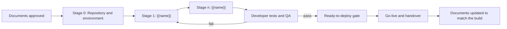

# {{Product Name}} — Project Documentation and Implementation Plan

| Field | Value |
|-------|-------|
| Project | {{Product Name}} |
| Document | Project Documentation and Implementation Plan |
| Version | 0.1 (Draft) |
| Date | {{YYYY-MM-DD}} |
| Prepared by | Generated with Claude, reviewed by {{name / [TBD]}} |
| Status | Draft |
| Source revision | {{Mode A: "Profile @ <SHA>". Mode B: "Brief v<n>, YYYY-MM-DD". Mode C: "Profile <slug> @ <SHA>; Modernization Brief v<n>, YYYY-MM-DD"}} |

## Table of Contents

## Read This First
<!-- Plain-language entry page (rules/35-readability.md) for the developer who opens
     the suite for the first time. Questions table (what am I building, where do I start,
     which document decides what, what is "done", when is it ready), the implementation
     route flow (rules/65 section 4), and the Where to Find What table.
     Add an 'In short' note under every numbered ## section:
     > [!NOTE]
     > **In short:** <one or two plain sentences> -->

## 1. Purpose and Audience
<!-- Who reads this (the development team, the technical lead, the project manager) and
     what they do after reading: find the right document, start the right stage, and keep
     the documents true while the code changes. Name the mode in plain words: finishing an
     existing system (A), building a new one (B), or rebuilding one on a new stack (C). -->

## 2. The Project in One Page
<!-- Product, purpose, main users, goals (G-xx), the starting point, and the target.
     Mode A: what exists and what remains (Plan section 3). Mode B: the idea and the
     agreed stack (Brief, Design section 3). Mode C: current system and target stack
     layer by layer (Brief Target Tech Stack). Copy facts; add nothing new. -->

| Item | Value | Source |
|------|-------|--------|
| Product | {{name}} | {{evidence base section}} |
| Mode | {{A: finish the existing system / B: build from zero / C: modernize}} | — |
| Main users | {{roles}} | {{section}} |
| Goals | {{G-xx list}} | {{section}} |
| Stack | {{Agreed / Proposed / [DECISION] per layer}} | {{section}} |
| Target date | {{date or [TBD]}} | {{plan section}} |

## 3. Documentation Set
### 3.1 Document Inventory
<!-- One row per document in output/<mode>/<slug>/ (and the repo docs or starter kit).
     Status and version come from each document's Document Control block. Owner is a role. -->

| # | Document | File | Purpose for the developer | Audience | Version / Status | Owner (role) |
|---|----------|------|---------------------------|----------|------------------|--------------|
| 00 | {{Evidence base}} | `{{file}}` | {{one line}} | {{roles}} | {{v / status}} | {{role}} |

### 3.2 Reading Order for Developers
<!-- Numbered: what to read on day one, what to read before each stage of section 5,
     what to keep open while coding. Give the section numbers, not just the document. -->

### 3.3 Where Each Fact Lives
<!-- Single source of truth per kind of fact, so two documents never compete.
     Feature list, requirements and acceptance criteria, data model, API, screens, roles
     and permissions, stack and versions, environments and config, test cases, estimates
     and dates, ready-to-deploy gate, glossary, words to avoid. -->

| Fact | Lives in | Everyone else |
|------|----------|---------------|
| {{Requirements and acceptance criteria}} | {{document section}} | {{cites it by ID}} |

### 3.4 How the Documents Depend on Each Other
<!-- Mermaid flow: evidence base → requirements / plan → design → test plan → manuals →
     this document; the kit copies the suite. Reuse the mode's generation-order table. -->

## 4. Implementation Approach
<!-- The strategy in plain words and where it is decided: Mode A finish-first order
     (Plan section 5 and 6); Mode B build in phases (Plan section 6); Mode C migration
     strategy, increments, parallel run, cutover (Brief, Migration Plan). Then the working
     agreement the team follows: start from a requirement or work item ID, build in layer
     order, tests with every change, no secrets or personal names, small reviewed changes,
     record new architecture choices as ADRs. Label Claude's additions **Proposed**. -->

## 5. Implementation Stages
<!-- One row per stage, in order. Stages equal the plan's phases or increments; do not
     invent new ones. Entry and exit criteria come from the plan; tests from the test
     plan (or Mode A Plan section Quality). Work items are the plan's WBS IDs. -->

| Stage | Goal | Governing documents and sections | Work items | Entry criteria | Exit criteria (done when) | Tests that prove it |
|-------|------|----------------------------------|------------|----------------|---------------------------|---------------------|
| {{0: Repository and environment}} | {{…}} | {{Design section 14 / Technical Manual section n / starter kit}} | {{WBS IDs}} | {{…}} | {{…}} | {{TC IDs or "smoke"}} |

## 6. Traceability
<!-- The chain requirement → design → work item → test → acceptance, with the ID forms
     used in this suite (F-xx, FR-xx, NFR-xx, WBS-xx, TC-xx, ADR-xx) and where the
     traceability matrix lives. How IDs appear in branch names, commits, pull requests,
     and test names (from the Developer Manual or the starter kit's git rule). -->

## 7. Development Workflow and Tooling
<!-- Repository and its layout; the build repository starter kit when one exists (what
     it contains, how to use /feature-dev and the kit skills); branches, reviews, and CI
     from the Developer Manual (Mode A) or Design and starter kit (Modes B and C). Mark
     planned commands "planned" until the build exists. No application code. -->

| Topic | What the team does | Source |
|-------|--------------------|--------|
| Repository | {{…}} | {{Design section 14 / Developer Manual section n}} |
| Branches and commits | {{…}} | {{…}} |
| Reviews | {{…}} | {{…}} |
| Continuous integration | {{…}} | {{…}} |
| Tools and skills | {{starter kit, /feature-dev, kit skills}} | {{Rule 40 starter kit section}} |

## 8. Quality Gates and Definition of Done
<!-- Definition of Done for one work item, for one stage, and for the project (copied
     from the plan). The ready-to-deploy gate exactly as the plan and test plan state it
     (rules/45 section 5): all Must tests pass, testers sign off, acceptance signed.
     Who signs, by role. Mode C adds parity and data-migration checks. -->

| Level | Done when | Checked by (role) | Source |
|-------|-----------|-------------------|--------|
| Work item | {{…}} | {{…}} | {{…}} |
| Stage | {{…}} | {{…}} | {{…}} |
| Ready to deploy | {{…}} | {{…}} | {{Plan section n; Test Plan section n}} |

## 9. Keeping the Documents True During the Build
<!-- The documentation duties that come with each kind of change. One row per trigger.
     Include: a requirement changes (Rule 55 order), a new architecture choice (ADR), a
     screen is built (User Manual draft becomes final), an environment or config key
     changes (Technical Manual), an interface changes (API doc), a stage ends (status in
     the inventory, Revision History), code exists for a Mode B or C plan (/new-gap-check,
     then Mode A skills for final manuals), and a release (versions). Name the command
     when this factory does the work. -->

| When this happens | Update this | Who (role) | How |
|-------------------|-------------|------------|-----|
| {{A requirement changes}} | {{Requirements, then Design, Plan, Test Plan, manuals, INDEX}} | {{…}} | {{`/… <slug> <change>` (Rule 55)}} |

## 10. Roles and Responsibilities
<!-- Roles only, never personal names (Rule 10): who decides scope, who builds, who
     tests, who approves the gate, who keeps each document. Reuse the plan's RACI. -->

| Role | Decides | Builds | Tests | Approves | Keeps up to date |
|------|---------|--------|-------|----------|------------------|
| {{Management}} | {{…}} | — | — | {{…}} | — |

## 11. Timeline Summary
<!-- Milestones copied from the plan with the same dates or relative phases and the same
     markers ([ASSUMPTION], [TBD]). No new dates. -->

| Milestone | When | Depends on | Source |
|-----------|------|------------|--------|
| {{…}} | {{date / "Phase n, ~k weeks after start" [ASSUMPTION]}} | {{…}} | {{Plan section n}} |

## 12. Risks to the Implementation
<!-- The plan's risks that change what the developers do, with the mitigation and the
     stage where it applies. Keep the plan's IDs and ratings. -->

| Risk | Likelihood × Impact | Stage | What the team does about it | Source |
|------|---------------------|-------|-----------------------------|--------|
| {{…}} | {{…}} | {{…}} | {{…}} | {{Plan section n, R-xx}} |

## 13. Glossary
<!-- Link to the evidence base's Glossary; define here only the terms this document adds
     (stage, gate, work item, traceability). -->

## Open Items
| # | Item | Owner | Needed by |
|---|------|-------|-----------|

## Revision History
| Version | Date | Author | Change |
|---------|------|--------|--------|
| 0.1 | {{YYYY-MM-DD}} | Claude | Initial draft |
