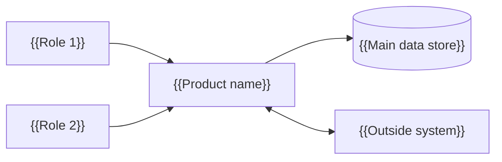
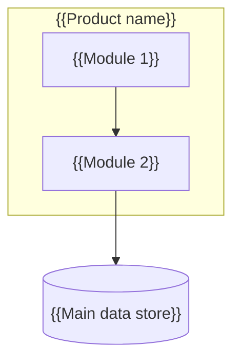
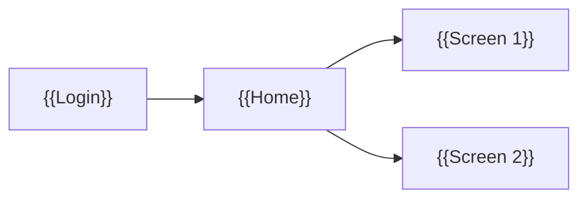
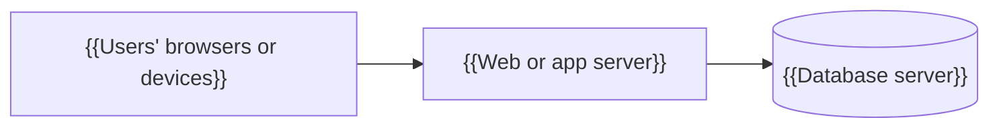

# {{Product Name}} — System Map

| Field | Value |
|-------|-------|
| Project | {{Product Name}} |
| Document | System Map |
| Version | 0.1 (Draft) |
| Date | {{YYYY-MM-DD}} |
| Prepared by | Generated with Claude, reviewed by {{name / [TBD]}} |
| Status | Draft |
| Source revision | {{Mode A: "Profile @ <SHA>". Mode B: "Brief v<n>, YYYY-MM-DD". Mode C: "Profile <slug> @ <SHA>; Modernization Brief v<n>, YYYY-MM-DD"}} |

## Table of Contents

## Read This First
<!-- Plain-language entry page (rules/35-readability.md, rules/70-system-map.md section 4).
     Questions table: what is the system, who uses it, what are its main parts, where does
     the data live, what does it connect to, where does it run, where is the detail.
     Picture: the "System in one picture" flow from section 2, identical source.
     Add the Where to Find What table (this document has more than 8 numbered sections).
     Add an 'In short' note under every numbered ## section:
     > [!NOTE]
     > **In short:** <one or two plain sentences> -->

## 1. Purpose and How to Read the Map
<!-- Who reads this (new team members, the technical lead, support, the project manager)
     and what they do after reading: find any part of the system and the document section
     that describes it in detail. Name the mode in plain words: the system as built (A),
     the planned system (B), or the current system and the target system (C). Explain the
     levels: context (section 2) → parts (sections 3–8) → cross-reference (section 9). -->

## 2. The System in One Picture
<!-- Context view: the people (roles), the system as one box, and every outside system it
     talks to. Mode C: two pictures, "Today" (present tense) and "Target" (future tense).
     Reuse the identical Mermaid source used by the proposal and design (Rule 35 section 4). -->

## 3. Users and Roles Map
<!-- One row per role: what they do in the system, which parts and screens they use, and
     their main permission. Roles only, never personal names (Rule 10). -->

| Role | What they do | Parts they use | Main permissions | Source |
|------|--------------|----------------|------------------|--------|
| {{Role}} | {{one line}} | {{parts from section 4}} | {{…}} | {{evidence section}} |

## 4. Parts of the System (Module Map)
<!-- Container and component view: every module or component, what it is responsible for,
     what it depends on, and the code location (Mode A) or proposed location (Modes B, C).
     A Mermaid component diagram of at most about 20 nodes; split by area if larger.
     Mode C: current parts, then target parts, then section 4.1. -->

| Part | Responsibility | Depends on | Location | Detail in |
|------|----------------|------------|----------|-----------|
| {{Module}} | {{one line}} | {{parts / data / outside systems}} | {{`path` or "Proposed: path"}} | {{document section}} |

### 4.1 Current to Target Parts (Mode C only)
<!-- Mode C: one row per current part → its target part, with the feature disposition
     (Keep / Improve / Replace / Drop / New) from the brief and the design's Component
     Mapping. Modes A and B: "Not applicable — no target system in this mode." -->

| Current part | Target part | Disposition | Source |
|--------------|-------------|-------------|--------|
| {{…}} | {{…}} | {{Keep / Improve / Replace / Drop / New}} | {{Design section n}} |

## 5. Screen and Navigation Map
<!-- How a user moves through the system: main menu → screens, grouped by part. Labels
     exactly as on screen (Mode A) or marked [VERIFY: final label] (Modes B and C). For a
     command-line or API-only product, map commands or endpoints by group instead. -->

| Screen | Reached from | Used by (role) | Part | Detail in |
|--------|--------------|----------------|------|-----------|
| {{Screen}} | {{menu path}} | {{role}} | {{part}} | {{User Manual section n}} |

## 6. Data Map
<!-- Where the data lives and who owns it: each data store (database, files, cache,
     outside store), the main entities in it, the part that writes them, the parts that
     read them, and sensitivity (personal, confidential, public). A small ERD of the main
     entities only; the full model stays in the data model section it cites. -->

| Data store | Main entities | Written by | Read by | Sensitivity | Detail in |
|------------|---------------|------------|---------|-------------|-----------|
| {{Store}} | {{entities}} | {{part}} | {{parts}} | {{…}} | {{document section}} |

## 7. Integration Map
<!-- Every outside system: direction (in, out, both), how it connects (file drop, API,
     database link, message, printer, device), what data moves, how often, and who owns the
     other side (role or organization). -->

| Outside system | Direction | Connects by | Data exchanged | Frequency | Owner | Detail in |
|----------------|-----------|-------------|----------------|-----------|-------|-----------|
| {{System}} | {{in / out / both}} | {{…}} | {{…}} | {{…}} | {{role}} | {{document section}} |

## 8. Deployment Map
<!-- Where each part runs: environments, servers or services, operating system, ports,
     and the network zones between them. Mode B and C target: Proposed or Agreed, with the
     markers the design carries. No secrets, host names or addresses that are private
     (Rule 00, item 6): use placeholders such as <APP_SERVER>. -->

| Environment | Part | Runs on | Port or address | Detail in |
|-------------|------|---------|-----------------|-----------|
| {{Production}} | {{part}} | {{<APP_SERVER>, OS}} | {{…}} | {{Technical Manual section n / Design section n}} |

## 9. Feature-to-System Cross-Reference
<!-- The index that ties the map together: one row per feature (F-xx) → the part that
     implements it → its main screen → the data it touches → the outside systems it uses →
     the document sections that describe it. Mode B and C: add the requirement IDs. Every
     feature in the evidence base appears exactly once (Mode C: Drop features with "—"). -->

| Feature | Part | Main screen | Data | Outside systems | Requirements | Detail in |
|---------|------|-------------|------|-----------------|--------------|-----------|
| {{F-01 name}} | {{part}} | {{screen}} | {{entities}} | {{— / system}} | {{FR-xx / —}} | {{document sections}} |

## 10. Main Flow Across the System
<!-- One real case from start to end, showing which part handles each step and where the
     data goes. Reuse the identical case-flow Mermaid source from the other documents
     (Rule 35 section 4), adding the part name to each step label when it fits. -->

## 11. Glossary
<!-- Link to the evidence base's Glossary; define here only the map terms this document
     adds (part, data store, outside system, environment). -->

## Open Items
| # | Item | Owner | Needed by |
|---|------|-------|-----------|

## Revision History
| Version | Date | Author | Change |
|---------|------|--------|--------|
| 0.1 | {{YYYY-MM-DD}} | Claude | Initial draft |
